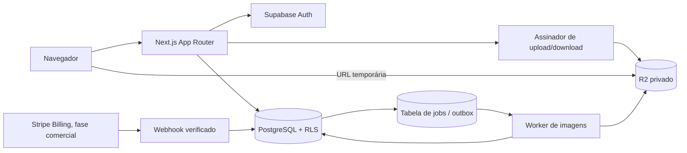
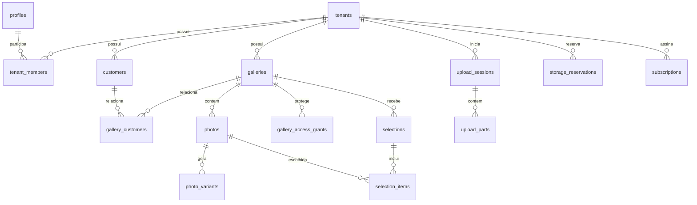

# Quadrics — Etapa A: direção de produto e arquitetura

**Estado:** proposta para validação, 21/10/2026. Este documento fixa a direção inicial; não representa código implementado nem aprovação de regras comerciais ou jurídicas.

## 1. Visão executiva

Quadrics é um SaaS para fotógrafos entregarem galerias privadas, recolherem seleções de clientes e disponibilizarem arquivos digitais. O primeiro lançamento deve provar que fotógrafos conseguem completar o ciclo **criar workspace → criar galeria → enviar imagens → compartilhar → receber seleção → entregar downloads** com segurança e custo previsível. A receita inicial pode vir de assinaturas; vendas avulsas exigem validação comercial e operacional separada.

**Personas e resultado esperado**

| Persona | Necessidade principal | Sinal de sucesso inicial |
|---|---|---|
| Fotógrafo autônomo | Enviar muitas fotos sem suporte técnico | Primeira galeria publicada e compartilhada |
| Pequeno estúdio | Separar trabalhos e acompanhar aprovações | Seleções recebidas sem mensagens manuais |
| Cliente final | Ver, escolher e baixar no celular | Acesso e conclusão da seleção sem cadastro obrigatório |

**Métrica norte proposta:** galerias entregues com ao menos uma ação do cliente por fotógrafo ativo, por mês. Instrumentar também tempo até primeira publicação, taxa de falha de upload, conclusão de seleção e custo de armazenamento por workspace. Metas numéricas dependem de pilotos.

## 2. Escopo recomendado do MVP

| Prioridade | Entrega | Limite deliberado |
|---|---|---|
| Obrigatório | Conta do fotógrafo, workspace com slug, associação de proprietário, clientes e galerias | Estrutura de membros preparada; convite de colaboradores depois |
| Obrigatório | Upload direto JPEG/PNG, retomada por partes para arquivos grandes, miniaturas e previews com marca d'água | Sem RAW no lançamento; limite por arquivo configurável após teste real |
| Obrigatório | Galeria privada por link com PIN opcional, expiração, publicação e arquivamento | Link dá acesso somente à galeria autorizada; nunca ao original |
| Obrigatório | Favoritos, envio de seleção, bloqueio após envio quando configurado, downloads autorizados | ZIP em lote pode entrar após validar volume e custo do worker |
| Obrigatório | Cota de armazenamento, painel simples, logs de operações sensíveis e suporte à exclusão | Planos comerciais e retenção dependem de política aprovada |
| Condicional | Stripe Billing | Entrar antes da cobrança real; piloto fechado pode usar concessão manual de plano, com trilha auditável |
| Posterior | Stripe Connect, venda de arquivos extras, reembolso, disputas | Só após validar país, modelo de negócio, responsabilidade fiscal e fluxo de pagamento |
| Posterior | RAW, impressão física, domínio próprio, colaboradores, branding avançado | Não bloquear o fluxo principal |

**Critério de lançamento beta:** dois workspaces de teste isolados; fluxo completo em desktop e celular; upload interrompido recuperável sem consumir cota indefinidamente; link expirado e usuário de outro tenant recebem negação; restauração de backup ensaiada; alertas operacionais mínimos ativos.

## 3. Arquitetura recomendada

**Monólito modular.** Next.js contém interface, endpoints de autorização e serviços de domínio. Um processo worker separado executa processamento pesado; ambos compartilham tipos e regras de domínio, sem expor chaves privilegiadas ao navegador. Começar com fila em PostgreSQL por tabela de jobs e leasing transacional, monitorada por profundidade e idade. Migrar para serviço de fila somente se throughput ou isolamento operacional justificarem.

**Fronteira de dados.** Supabase Auth identifica o usuário. `tenant_members` decide participação e papel. Consultas de dados de negócio usam sessão do usuário e RLS, com políticas por operação. `service_role` fica restrita a webhooks e workers, com funções estreitas e auditoria; nunca é um cliente de dados genérico de Server Actions. Toda referência a entidade de tenant carrega `tenant_id` e FK composta para impedir relação cruzada.

**Galerias públicas.** Usar `/g/[tenantSlug]/[gallerySlug]`, evitando colisão com landing e rotas internas. Link compartilhável contém token aleatório de alta entropia, armazenado como hash; PIN tem hash com algoritmo apropriado e limite de tentativas. Após validação no servidor, emitir sessão de galeria curta em cookie `HttpOnly`, `Secure`, `SameSite=Lax`, associada à galeria e à versão de acesso. Mudanças de permissão invalidam sessões. URLs de originais são emitidas sob demanda após autorização e expiram rapidamente. Previews podem usar cache controlado, sem tornar originais públicos.

**Upload.** O backend autentica membro, valida galeria, tipo e tamanho, reserva cota e cria chave de objeto opaca. O navegador envia diretamente ao R2 por URL assinada. Para arquivo grande, usar multipart com partes uniformes e ETags persistidos; o backend conclui e verifica objeto por `HEAD` antes de confirmar metadados e enfileirar variantes. Estados propostos: `reserved → uploading → uploaded → processing → ready`, com `failed`, `expired` e `deleted`. Cada transição tem chave idempotente e job de reconciliação; PostgreSQL e R2 não participam de uma transação distribuída. Reservas expiram e objetos órfãos são removidos por reconciliação. R2 documenta multipart retomável e expiração padrão de uploads incompletos em sete dias. [Fonte](https://developers.cloudflare.com/r2/objects/upload-objects/).

**Pagamentos.** Billing e Connect ficam em módulos distintos. No Billing, webhook com assinatura verificada atualiza projeção local da assinatura; evento duplicado é ignorado por ID e estados são reconciliados com a API Stripe. Navegação de sucesso do checkout não ativa direitos. Para Connect, a modalidade de cobrança e o responsável por taxas, disputas e reembolsos dependem de validação do arranjo brasileiro; nenhuma liberação de compra ocorre antes da confirmação confiável do pagamento. A Stripe lista o Brasil como país suportado, mas isso não valida automaticamente toda combinação de Connect, capacidade e fluxo transfronteiriço. [Disponibilidade](https://stripe.com/global), [restrições brasileiras](https://support.stripe.com/questions/transaction-declined-stripe-brazil-accounts?locale=en-GB).

## 4. Decisões técnicas fundamentais

| Decisão proposta | Motivo | Revisar quando |
|---|---|---|
| Next.js App Router com Server Components para leitura, Server Actions para formulários e Route Handlers para upload/webhooks | Mantém interface e domínio próximos; cada mutação revalida identidade e permissão | Contratos externos ou carga exigirem serviço dedicado |
| Supabase Auth + PostgreSQL RLS, sem seleção de tenant confiada ao navegador | Suporta usuário em vários workspaces e defesa em profundidade | Testes de isolamento ou performance mostrarem falha |
| SQL versionado como fonte de verdade; Drizzle para consultas tipadas, após prova de integração com RLS | SQL expressa constraints e políticas; ORM não deve ocultar contexto de autorização | Se Drizzle complicar transações com sessão de usuário, usar cliente Supabase nas rotas sensíveis |
| R2 Standard privado e variantes geradas por worker com Sharp | Originais protegidos, custo proporcional ao uso; Sharp resolve JPEG/PNG no MVP | Volume ou formato exigir processamento especializado |
| React Hook Form + Zod só em formulários com validação interativa; estado local por padrão | Evita dependências globais sem necessidade | Complexidade de formulários ou estado compartilhado aumentar |
| PostgreSQL jobs no início | Menor custo e infraestrutura; falhas recuperáveis por lease e retry | Fila crescer além da capacidade medida do banco |
| Hospedagem inicial em serviço gerenciado que suporte Next.js e processo worker persistente | Operação simples, sem Kubernetes | Dados de carga e custo indicarem separação |

As APIs exatas e versões devem ser fixadas no início da implementação. A documentação atual do Next.js chama Middleware de **Proxy** desde a versão 16; Proxy serve para roteamento e verificações preliminares, não para autorização final. [Next.js](https://nextjs.org/docs/app/getting-started/proxy). Na Supabase, grants e políticas RLS são controles distintos, e credenciais privilegiadas contornam RLS. [Supabase](https://supabase.com/docs/guides/database/postgres/row-level-security).

## 5. Modelo de dados conceitual

`profiles` referencia `auth.users`; `tenant_members` usa chave `(tenant_id, user_id)` e papel. `galleries`, `customers`, `photos`, `selections` e entidades transacionais carregam `tenant_id`. Relacionamentos internos usam FKs compostas, por exemplo `(tenant_id, gallery_id)` e `(tenant_id, photo_id)`. `gallery_access_grants` guarda hash do token, escopo, expiração e revogação; sessão do visitante nunca equivale a membro do tenant. `upload_sessions` e `storage_reservations` guardam estado e prazo. `jobs`, `webhook_events` e `audit_logs` são privados ao backend. `plans`, `orders`, `order_items`, `payments` e `connected_accounts` entram com as fases financeiras. `storage_usage` pode ser contador materializado reconciliado com objetos reais.

**Política de exclusão proposta:** exclusão lógica de galeria inicia job de remoção de objetos; registro de tombstone persiste até reconciliação. Clientes e fotos seguem prazos de retenção definidos em contrato; logs mínimos de auditoria podem exigir prazo diferente. Não apagar imediatamente por inadimplência. Prazos, base legal, papéis de controlador/operador, transferência internacional e direitos do titular requerem revisão jurídica.

## 6. Riscos prioritários

| Risco | Prob. | Impacto | Mitigação inicial | Responsável |
|---|---|---|---|---|
| Vazamento entre tenants | Média | Crítico | FKs compostas, RLS, grants mínimos e testes negativos automatizados | Engenharia + segurança |
| Upload interrompido e cota incorreta | Alta | Alto | Reserva com TTL, idempotência, multipart e reconciliação diária | Engenharia backend |
| Custo de mídia acima da receita | Média | Alto | Medir bytes e operações por tenant, limites de plano e alertas | Produto + operações |
| Link compartilhado indevidamente | Alta | Médio | Token revogável, PIN opcional, expiração e rate limit | Produto + segurança |
| Processamento de imagem maliciosa ou muito grande | Média | Alto | Validação por conteúdo, limites de pixels/tempo/memória e worker isolado | Segurança + operações |
| Connect no Brasil, impostos e disputas | Alta | Alto | Prova de conceito e revisão jurídica/comercial antes da venda | Produto + financeiro |
| Exclusão acidental ou dados órfãos | Média | Alto | Tombstones, backup testado e reconciliação R2/banco | Operações |

## 7. Roadmap macro e caminho crítico

Estimativa **hipotética** para uma pessoa full stack e apoio parcial de design/segurança, sprints de duas semanas. Replanejar após discovery e prova de upload.

| Sprint | Entregável demonstrável | Dependência e aceite principal |
|---|---|---|
| 0 | PRD enxuto, decisões pendentes resolvidas, protótipo de fluxos | Entrevistas com fotógrafos e escopo fechado |
| 1 | Base Next.js, Supabase local, migrations, CI e interface base | Build e testes no Linux Mint/Docker |
| 2 | Auth, workspaces e RLS | Usuário de A não lê/escreve B |
| 3 | Clientes, galerias e sessão de acesso | Link expirado/revogado nega acesso |
| 4–5 | Upload direto, cotas, worker e variantes | 1.000 arquivos de teste com falhas simuladas e sem reserva presa |
| 6 | Seleções, downloads e painel essencial | Original só é entregue com permissão; fluxo móvel completo |
| 7 | Beta fechado e hardening | Backup restaurado, observabilidade e métricas operantes |
| 8+ | Billing para cobrança real; Connect em trilha separada | Webhooks idempotentes e validação comercial concluída |

**Caminho crítico:** isolamento → acesso à galeria → upload/cotas → processamento → seleção/download → beta. Billing precisa estar pronto antes da primeira cobrança, mas não antes de um piloto gratuito. Connect e RAW não condicionam o beta.

## 8. Questões estratégicas pendentes

1. Piloto: quantos fotógrafos, qual perfil, qual volume mensal médio e quais formatos realmente necessários?
2. O cliente final precisa só selecionar ou também aprovar formalmente uma entrega? Qual regra de edição após envio?
3. Quem define a retenção e exclusão de fotografias e quais compromissos contratuais serão oferecidos?
4. A operação inicial será exclusivamente Brasil/BRL? Quem será vendedor responsável nas compras digitais e quem absorve taxas, estornos e tributos?
5. Qual volume de armazenamento e preço sustentam cada plano? Os exemplos 50/200/1.000 GB são hipóteses de produto.
6. Qual nível de personalização visual é indispensável para atrair os primeiros fotógrafos?

**Próxima entrega da Etapa A:** especificação detalhada, numerada, começando por PRD e definição formal do MVP, seguida de ADD/ADRs, SQL e RLS executáveis, contratos de upload, segurança, UX, infraestrutura, testes, custos e backlog. Cada artefato deve conter critérios de aceitação e ser revisado antes de virar código de produção.
